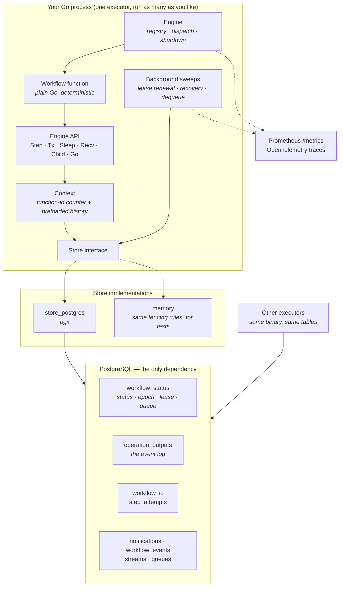
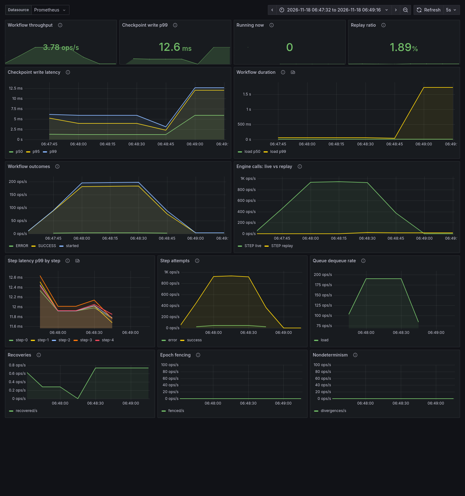
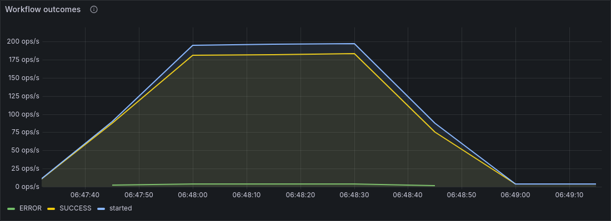
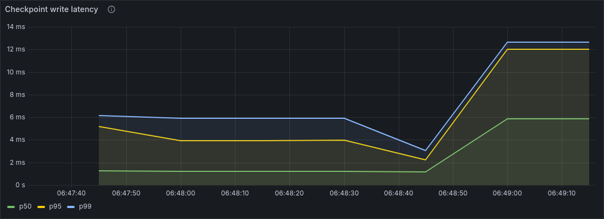
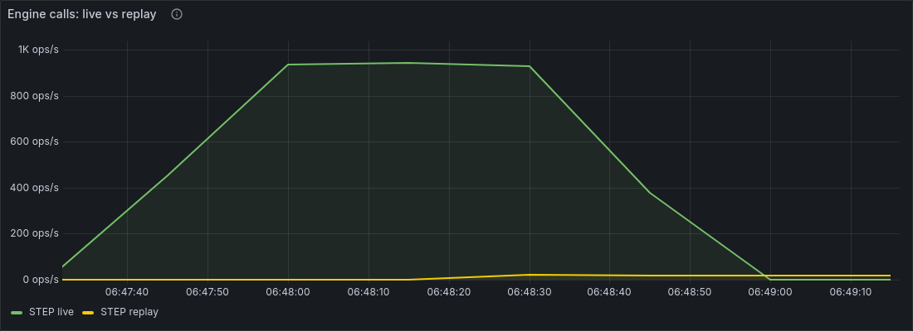
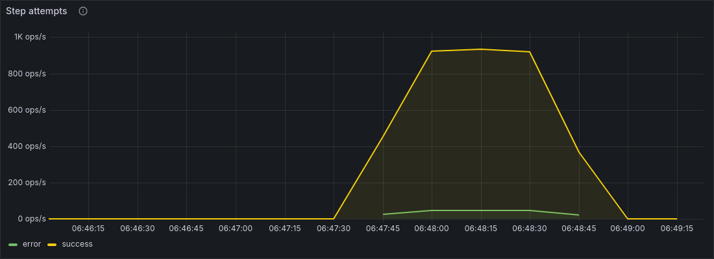
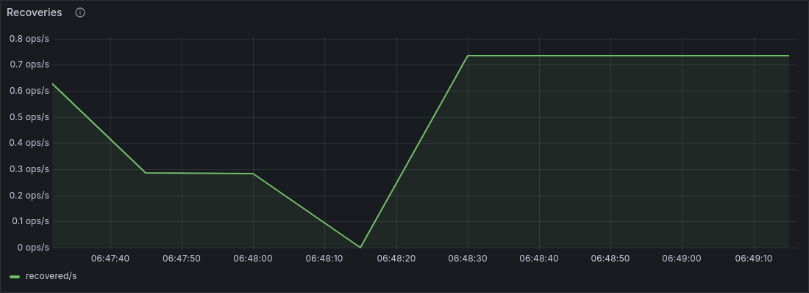

# anchora
A Postgres-native durable execution engine for Go. A workflow is a plain Go
function; every engine call it makes is checkpointed in Postgres before its
result is returned. If the process dies, the workflow is re-executed from the
top: recorded calls replay from the database without repeating side effects,
and execution resumes at the first call with no recorded result.


Requires Go 1.26+ and Postgres 12+. [Architecture](#architecture) has the
diagrams; [Performance](#performance) has measured numbers, including what a
`kill -9` costs.

## Architecture

anchora is a library. The engine runs inside your process and Postgres holds
every piece of state, so any process that imports the package and registers
the same workflow names is an interchangeable executor. Scaling
out means starting another copy; there is nothing else to deploy.



The only coupling between executors is the database. A lease column says which
executor currently owns a workflow and an epoch column settles who wins when
two of them disagree, which is what lets a crashed executor's work be picked up
without a coordinator deciding who picks it up.

### Request flow

The path a single workflow takes, including what happens when the process
holding it dies.

```mermaid
sequenceDiagram
    autonumber
    participant C as Caller
    participant E as Engine A
    participant W as Workflow fn
    participant P as Postgres
    participant B as Engine B

    C->>E: Research.Start with WorkflowID req-123
    E->>P: INSERT workflow_status, PENDING at epoch 0
    Note over P: the id is the idempotency key<br/>a second Start returns this row
    P-->>E: row
    E-->>C: Handle

    E->>P: LoadCheckpoints req-123
    P-->>E: history, empty on a first run
    E->>W: run with Context

    rect rgb(28,46,36)
        Note over W,P: every engine call takes a slot
        W->>W: reserve function_id from the counter
        W->>W: slot in history? → return recorded value, do not run
        W->>W: not in history → run the side effect
        W->>P: INSERT operation_outputs, fenced on epoch,<br/>ON CONFLICT DO NOTHING
        P-->>W: written, or the winner's recorded value
        W-->>W: only now is the result returned to the code
    end

    Note over E,P: lease renewed while the workflow runs

    rect rgb(60,30,30)
        Note over E: Engine A is SIGKILLed mid-workflow
        E--xP: lease stops being renewed
    end

    B->>P: recovery sweep: claim rows whose lease expired
    P-->>B: req-123 at epoch 1, so A's writes are now fenced out
    B->>P: LoadCheckpoints req-123
    P-->>B: every slot A had committed
    B->>W: re-execute the function from the top
    Note over W: recorded slots replay from the rows —<br/>no HTTP call, no payment, no LLM spend repeated
    W->>P: first unrecorded slot runs live, then checkpoints
    B->>P: UPDATE workflow_status → SUCCESS + output
    C->>P: Handle.Result polls the row
    P-->>C: output
```



Three properties follow from that shape:

- A result is observed only after it is durable: the checkpoint write happens
  before the return, so there is no window where code holds a value that
  Postgres does not.
- Two executors cannot both win. Checkpoint inserts are fenced on the epoch and
  `ON CONFLICT DO NOTHING` makes the first writer authoritative. The loser
  adopts the winner's value.
- Side effects are at-least-once, except in `Tx`. A crash between running a
  step and committing its checkpoint repeats that step. `Tx` commits the
  business write and the checkpoint in one transaction, which makes those steps
  exactly-once.

## Guarantees

| Property | How |
| --- | --- |
| The workflow is a row | `anchora.workflow_status` plus its input/output in `anchora.workflow_io` |
| A result is observed only after it is durable | every step writes `anchora.operation_outputs` before returning |
| Replay is exact | one monotonic function-id counter per execution; each call reads its recorded slot first |
| Side effects are at-least-once | a crash between a live call and its checkpoint repeats that call |
| Transactional steps are exactly-once | the business writes and the checkpoint commit in one Postgres transaction |
| Two executors never both win | checkpoint inserts are fenced on the execution's epoch; first writer wins |
| A dead executor is recovered | leases expire, another executor claims with a higher epoch and replays |
| Divergent code fails loudly | recorded kind/name at a function slot must match what the code calls |

## Quick start

```go
eng, err := anchora.New(ctx, anchora.Config{
    DatabaseURL: os.Getenv("DATABASE_URL"),
})
if err != nil {
    log.Fatal(err)
}
defer eng.Shutdown(ctx)

// Register before Launch (Start launches the engine on first use).
var Research = anchora.RegisterWorkflow(eng, "research_agent", researchAgent)

h, err := Research.Start(ctx, "Summarize X", anchora.WithWorkflowID("req-123"))
if err != nil {
    log.Fatal(err)
}
report, err := h.Result(ctx)
```

The workflow id is the idempotency key: starting the same id again returns a
handle to the existing execution instead of running a duplicate.

## A workflow

```go
func researchAgent(ctx *anchora.Context, task string) (Report, error) {
    plan, err := anchora.Step(ctx, "plan", func(sc anchora.StepCtx) (Plan, error) {
        return llm.Plan(sc, task) // runs once; the result is checkpointed
    }, anchora.Retry(5, time.Second, 2), anchora.Timeout(60*time.Second))
    if err != nil {
        return Report{}, err
    }

    notes, err := anchora.Step(ctx, "search", func(sc anchora.StepCtx) ([]Note, error) {
        return tools.Search(sc, plan.Queries)
    })
    if err != nil {
        return Report{}, err
    }

    approved, err := anchora.Recv[bool](ctx, "approval", 24*time.Hour) // durable wait
    if err != nil {
        return Report{}, err
    }
    if !approved {
        return Report{}, ErrRejected
    }

    if err := anchora.Sleep(ctx, 10*time.Minute); err != nil { // durable timer
        return Report{}, err
    }
    now, err := anchora.Now(ctx) // recorded clock read
    if err != nil {
        return Report{}, err
    }
    return anchora.Tx(ctx, "store", func(sc anchora.StepCtx, tx anchora.TxConn) (Report, error) {
        report := buildReport(notes, now)
        _, err := tx.Exec(sc, `INSERT INTO reports (id, body) VALUES ($1, $2)`, ctx.WorkflowID(), report.Body)
        return report, err
    })
}
```

## API

| Call | Purpose |
| --- | --- |
| `Step(ctx, name, fn, opts...)` | run an arbitrary side effect once and checkpoint its output |
| `Tx(ctx, name, fn, opts...)` | run business SQL and the checkpoint in one transaction |
| `Go(ctx, name, fn)` → `Future[T]` | start a step in parallel; deterministic slots in program order, `Wait` for the result |
| `Now` / `Random` / `UUID` | recorded replacements for nondeterministic reads |
| `Sleep(ctx, d)` | durable timer; replays sleep only the remaining duration |
| `Send(ctx, destID, topic, msg)` | send a durable message exactly once per step slot |
| `Recv[T](ctx, topic, timeout)` | consume a message and checkpoint it atomically |
| `SetEvent(ctx, key, v)` / `GetEvent[T](id, key, timeout)` | publish/observe key events; reads are recorded |
| `WriteStream(sc, key, chunk)` / `Engine.Stream` | append-only side channel for token streams and traces |
| `Child(ctx, workflow, input)` | start a child workflow with a deterministic id and await it |
| `Enqueue(ctx, workflow, input, opts...)` | enqueue a child onto a queue as a recorded operation |
| `ContinueAsNew(ctx, workflow, input)` | end this execution and carry state into a fresh one |
| `Patched(ctx, "name")` | branching into new behavior for new histories only |
| `anchora.Fork(ctx, workflow, id, fromSlot)` | rerun a recorded workflow from a slot without repaying earlier steps |
| `Workflow.Start` / `Handle.Result` | start an execution and wait for its output |
| `Engine.RegisterQueue` | drain a named queue with concurrency, rate, and partition limits |
| `Engine.Cancel` | cancel a pending workflow anywhere in the fleet |
| `Engine.Workflow` / `Engine.ListWorkflows` / `Engine.WorkflowEvent` / `Engine.Stream` | inspect state for operators and UIs |

Step options: `Retry(maxAttempts, initialBackoff, factor)`, `Timeout(d)`,
`NonRetryable(func(error) bool)`, `HeartbeatTimeout(d)`, plus `StepOptions` for
`ScheduleToClose`, `MaxBackoff`, and jitter. `StepCtx` embeds
`context.Context`, exposes `Attempt()`, `IdempotencyKey()`, and
`Heartbeat(details)`. The heartbeat timeout cancels an attempt that stops
heartbeating, which catches a wedged activity before the start-to-close
timeout would.

`TxConn` is the subset of `pgx.Tx` a transaction step receives (`Exec`,
`Query`, `QueryRow`), so the transaction is the real Postgres transaction that
receives the checkpoint.

## How a step executes

1. Reserve `function_id` from the execution's counter.
2. Look it up in the preloaded history. If present, verify the recorded kind and
   name, then return the recorded value or error. `fn` does not run.
3. Run `fn` with retries, timeouts, and heartbeats. Attempt rows go to
   `anchora.step_attempts`.
4. Insert the checkpoint with the execution's epoch. The insert only happens if
   the workflow row still has that epoch, and `ON CONFLICT DO NOTHING` makes the
   first writer win.
5. If the insert lost, use the winner's recorded value. If the epoch was stale,
   abort with `ErrFenced`.

A cancelled or shut-down execution writes no terminal step checkpoint, so the
workflow stays resumable.

## Schema

All state lives in the `anchora` schema, created by embedded migrations on
`Launch`:

| Table | Contents |
| --- | --- |
| `workflow_status` | one row per execution: name, status, app version, executor, lease, epoch, recovery attempts, queue and priority, partition key, deadline, parent, forked-from, continuation |
| `workflow_io` | inputs, output, error (split out so status updates do not rewrite payloads) |
| `operation_outputs` | the event log: one row per completed operation, keyed by `(workflow_id, function_id)` |
| `step_attempts` | live attempts, heartbeat time, and heartbeat details |
| `notifications` | durable messages between workflows, consumed transactionally |
| `workflow_events` | published key/value events (`SetEvent` / `GetEvent`) |
| `streams` | append-only chunked streams (`WriteStream`), tailed by `Engine.Stream` |
| `queues` | queue configuration: global and worker concurrency, rate limit, partition concurrency |

## Queues

A queue is a name over `ENQUEUED` rows. `WithQueue`, `WithPriority`, and
`WithPartition` tag the row; `Engine.RegisterQueue` starts draining it on this
executor:

```go
eng.RegisterQueue(ctx, anchora.Queue{
    Name:                  "llm",
    LocalConcurrency:      4,               // per executor
    GlobalConcurrency:     20,              // across the fleet
    PartitionConcurrency:  2,               // per tenant, so one cannot starve the rest
    RateLimitCount:        100,
    RateLimitPeriod:       time.Minute,     // provider RPM budgets
})
```

The dequeue sweep claims rows oldest-first by partition and highest-priority
first, bumps the epoch, and dispatches them. Local enqueues kick the sweep
immediately; a poll tick covers enqueues from other processes. An enqueue made
from inside a workflow is a recorded operation with the child id derived from
its slot, so a replaying parent reattaches to the same queue row instead of
enqueueing a duplicate.

## Fork, patches, and continuations

- `anchora.Fork(ctx, workflow, sourceID, fromSlot)` copies the source's history
  below the slot and runs live from there: rerun an agent from step 7 without
  repaying steps 1 to 6.
- `anchora.Patched(ctx, "use-new-planner")` returns true for fresh executions
  (recording a marker) and false for replays of older history, letting you add
  behavior while old executions replay their old branch.
- `anchora.ContinueAsNew(ctx, workflow, state)` ends the current execution and
  starts a fresh one with a fresh history; awaited handles follow the chain.
  Long-running agent loops call it before their history becomes unbounded.

## Testing

```sh
task check                 # gofmt check, go vet, go test -race ./...
go test -race ./...

# Postgres integration tests (they skip without a URL):
task test-integration      # starts docker compose, then runs everything
task cover                 # statement coverage including the Postgres-only paths
```

Unit tests run entirely on `anchora/memory`, an in-memory `anchora.Store` with
the same fencing and first-writer-wins rules. They cover replay and crash
recovery (including mid-`Sleep`, mid-`Recv`, and mid-parallel-`Go` crashes),
nondeterminism detection, zombie-epoch fencing, retries/timeouts/heartbeats,
children, messaging, events, streams, fork, patching, continuations, queue
concurrency caps and rate limits, enqueue idempotence across a restart, and
cancellation. The `agent` package is tested with a scripted provider, its
actual `Provider` interface.

The integration tests run the same scenarios against real Postgres:
transactional-step exactly-once, recovery after executor loss, epoch fencing,
Send/Recv, queues, fork, events and streams, continuations, migration
idempotency, enqueue idempotence across a restart, and error replay. They run
only when `anchora_TEST_DATABASE_URL` is set.

## Replay testing

`anchora/anchoratest` replays a recorded history against changed code:

```go
history, _ := anchoratest.History(ctx, store, "req-123")
if _, err := anchoratest.Replay(t, newCode, "research_agent", history, input); err != nil {
    // ErrNondeterminism names the first slot where new code diverges.
}
```

Recorded steps return their stored values without running; the first slot
without a recording runs live. A history produced by the old code validates a
deploy before it ships.

## Performance

Every number below came from `./cmd/anchora-load` and `./scripts/dashboard-demo.sh`
on an Apple M4 (10 cores, 24 GB) against Postgres 17 in Docker, both on the
same machine. Postgres in a Docker VM has a slower `fsync` than a tuned server
on real hardware, so the latency column is a floor you can beat on better
hardware. Reproduce them with:

```sh
task load -- -workflows 3000 -concurrency 16 -steps 5   # throughput and latency
task bench                                              # in-process Go benchmarks
task dashboard                                          # the full scenario, rendered
```

### What durability costs

The engine and the database are measured separately, because they are not the
same order of magnitude:

| | throughput | per checkpointed step |
| --- | --- | --- |
| Plain Go function call (no engine) | n/a | 0.35 ns |
| Engine with the in-memory store | 575,000 checkpoints/s | 1.9 µs |
| Engine with Postgres | 4,000 checkpoints/s | 2.4 ms |

The engine is roughly 140× faster than the Postgres it writes to, so about
0.08% of a durable step is anchora and the rest is the commit. The library is
meant to be invisible next to the `fsync` that makes the step durable. anchora
runs about as fast as your Postgres, so tuning effort belongs on the database.

### Where it saturates

Throughput against one Postgres, 5 steps per workflow, raising client
concurrency:

| concurrency | workflows/s | checkpoints/s | p50 | p95 | p99 |
| ---: | ---: | ---: | ---: | ---: | ---: |
| 2 | 761 | 3,805 | 2.4 ms | 4.1 ms | 6.1 ms |
| 4 | 842 | 4,211 | 4.8 ms | 6.2 ms | 6.4 ms |
| 8 | 763 | 3,813 | 9.8 ms | 18.0 ms | 24.9 ms |
| 16 | 826 | 4,128 | 19.0 ms | 25.2 ms | 38.5 ms |
| 32 | 807 | 4,033 | 37.7 ms | 50.0 ms | 51.1 ms |
| 64 | 807 | 4,035 | 74.1 ms | 101.0 ms | 165.4 ms |
| 128 | 781 | 3,903 | 141.2 ms | 202.3 ms | 344.4 ms |

Throughput is flat at ~800 workflows/s from concurrency 2 onward while latency
doubles with every doubling of concurrency. The system is saturated: past the
knee at about 4 concurrent writers, extra load turns into queue depth. The
useful operating point is the top of that table, and the way to move it is a
faster disk, a tuned `fsync`, or sharding across databases. More goroutines do
not help.

A sustained run holds the same rate: 90,000 workflows and 449,826 durable
writes in 2m00s, with all 90,000 bodies executing exactly once.

### What a crash costs

For a durable execution engine, what survives `kill -9` matters more than
throughput. `./scripts/dashboard-demo.sh` starts a batch, SIGKILLs the executor
holding it, and brings up a fresh one over the same workflow ids. How many
executions are caught in flight depends on exactly when the kill lands, so the
counts move between runs while the final state and the checkpoint rows stay the
same:

| | |
| --- | --- |
| Executions orphaned by the kill | 219 |
| Recovered by the new executor | 219 (`anchora_recoveries_total`) |
| Operations served from recorded history | 1,055 |
| Operations that re-ran live | 40 |
| Final state | 600 / 600 `SUCCESS` |
| Checkpoint rows after recovery | unchanged; no duplicated side effects |

1,055 of 1,095 operations (96%) replayed from Postgres without re-running.
The 40 that ran again were precisely the steps in flight at the instant of the
kill, which is the at-least-once boundary the design documents: a step that
has run but not yet committed its checkpoint runs again. `Tx` removes even
those by committing the business write and the checkpoint together.

### Test suite

| | |
| --- | --- |
| Tests | 44, all under `-race` |
| Statement coverage, engine core | 70.0% with Postgres, 51.5% without |
| Statement coverage, determinism linter | 87.0% |
| Postgres-only paths | `store_postgres.go`, 462 statements, covered only when `anchora_TEST_DATABASE_URL` is set |

The same scenarios run twice, once against `anchora/memory` and once against
real Postgres; the gap between the two coverage figures is the Postgres-only
code. The in-memory store reimplements the same fencing and first-writer-wins
rules, so the fast suite still exercises them.

## Metrics and dashboards

The engine registers into the default Prometheus registry, so an application
already serving `promhttp` exports it with no extra wiring:

| Metric | What it answers |
| --- | --- |
| `anchora_checkpoint_duration_seconds` | what durability costs right now |
| `anchora_operations_total{kind,source}` | how many calls ran vs replayed from history |
| `anchora_workflows_completed_total{workflow,status}` | throughput and failure rate |
| `anchora_workflow_duration_seconds` | end-to-end execution time |
| `anchora_step_attempts_total{step,outcome}` | which steps are retrying |
| `anchora_recoveries_total` | executions claimed from dead executors |
| `anchora_fenced_total` | writes rejected by a newer epoch |
| `anchora_nondeterminism_total` | replays whose code no longer matches history; should be flat zero |

A Prometheus and Grafana stack is included, with the dashboard provisioned
from source:

```sh
task obs-up                 # Postgres, Prometheus, Grafana, headless renderer
task dashboard              # drive load, crash an executor, render to docs/img/
open http://localhost:3000  # dashboard "anchora — durable execution"
```

The dashboard is provisioned from `deploy/grafana/dashboards/anchora.json`, so
it lives in version control, and the screenshots below are regenerated by the
same command that produces the load.



The script drives the full scenario: steady queued load with injected retries,
an executor killed mid-flight, then recovery. The panels cover the failure
states as well as the healthy ones.

Throughput and terminal statuses, against the dispatch rate:



Checkpoint write latency, the durability cost in isolation:



Engine calls split by whether they ran or replayed. Replay sits at zero while
the fleet is healthy; the small rise after the kill is 1,055 recorded steps
coming back from Postgres instead of running again. Replay is what a crash
costs, so it stays rare next to steady load:



Step attempts, where retries are the gap between the success and error lines
(this run injected a 5% first-attempt failure rate):



Recoveries, the executions claimed from the executor that was killed:



## Determinism rules

Workflow bodies must make the same sequence of engine calls on every replay:

- use `anchora.Now`, `anchora.Random`, and `anchora.UUID` instead of `time.Now`,
  `math/rand`, and direct id generation;
- use `anchora.Sleep` instead of `time.Sleep`;
- wrap every network or database call in `Step` or `Tx`;
- do not spawn bare goroutines that make engine calls; engine calls are
  positional, so start them in program order.

A recorded call is matched by position, kind, and name. Running different code
against an existing history returns `ErrNondeterminism` naming both operations,
and fails the workflow instead of producing a wrong result.

Errors rehydrated from history keep the engine's sentinels matchable
(`errors.Is(err, anchora.ErrTimeout)`, `ErrCancelled`, `ErrFenced`,
`ErrNondeterminism`). Other errors come back as `*anchora.StepError` with the
original type name and message.

## Recovery and versioning

`Launch` runs a startup sweep, then a periodic sweep (`RecoveryInterval`) claims
pending workflows whose lease expired, bumps their epoch, and re-executes them
from history. Each executor renews its leases every lease/3; a workflow missing
from the renewal result was cancelled or taken over, so its run is cancelled.
`MaxRecoveryAttempts` moves a crash-looping workflow to `RETRIES_EXCEEDED`.

Recovery is gated on `AppVersion`: an executor only picks up workflows stamped
with its own version, so old and new binaries can run side by side during a
deploy. The default version hashes the registered workflow names and Go runtime
version; set `Config.AppVersion` explicitly to pin a build. The
[patching API](#fork-patches-and-continuations) covers code changes that must
apply to in-flight histories.

`Engine.Shutdown` cancels in-flight workflows and leaves them `PENDING`;
another executor takes them over when their lease expires, replaying every
completed step.

## Tooling

- `cmd/anchora`, the operator CLI: `list`, `get <id>`, `steps <id>`, `cancel`,
  `resume`, `fork <id> --from <n>`, `gc --older-than 30d`. Reads
  `DATABASE_URL`.
- `anchora/anchoravet`, a `go/analysis` linter that fails workflow functions
  that call `time.Now`, `math/rand`, `net/http`, `os` env lookups, direct UUID
  generation, or spawn bare goroutines. Step bodies (`StepCtx` first parameter)
  are exempt. Run: `go vet -vettool=$(which anchoravet) ./...`.
- OpenTelemetry: a span per workflow execution and per step attempt with
  workflow id, function id, and attempt attributes; wire any `otel.Tracer`.
- Prometheus: checkpoint writes and durations, recoveries, dequeued counts,
  registered on the default registerer.

## AI agent layer

`anchora/agent` builds durable agents on the engine: provider adapters for
OpenAI-compatible APIs (including Ollama) and Anthropic, a JSON-schema tool
registry, and a docker-backed `Sandbox` tool. `agent.Run` drives the
replay-safe loop. Every model call and every tool invocation is a named step,
so a crash mid-loop resumes at the exact call without repeating paid work:

```go
messages := []agent.Message{{Role: agent.RoleUser, Content: task}}
out, err := agent.Run(ctx, "agent", agent.RunConfig{
    Call:    agent.CallConfig{Provider: openai.New(os.Getenv("OPENAI_API_KEY"))},
    Model:   "gpt-4o-mini",
    System:  sys,
    Tools:   registry,
    Budget:  &agent.Budget{MaxTotalTokens: 200_000},
    MaxTurns: 8,
}, messages)
```

`agent.Call` wraps a single completion; `agent.Budget` fails the run
deterministically when tokens or cost exceed the cap, using recorded usage so
replays agree. `examples/research-agent` is a complete runnable example with
parallel search legs, an approval gate, and provider selection.

## Layout

```
anchora/
  anchora.go        Engine, Config, registry, execution, shutdown
  errors.go        sentinel errors rehydrated with checkpoints
  context.go       workflow context, function-id counter, checkpoint persistence
  step.go          Step, StepCtx, retries, timeouts, heartbeats
  tx.go            Tx steps
  primitives.go    Now, Random, UUID, Sleep
  uuid.go          time-ordered UUIDv7 workflow ids
  concurrency.go   Go, Future
  queue.go         queues, Enqueue, dequeue sweep
  events.go        SetEvent, GetEvent
  stream.go        WriteStream, Engine.Stream
  fork.go          Fork
  patch.go         Patched
  continue.go      ContinueAsNew
  crash.go         anchora_CRASH_AFTER fault hook
  metrics.go       Prometheus metrics: checkpoints, replays, recoveries, fencing
  messaging.go     Send, Recv
  child.go         Workflow handles, Handle.Result, Child
  recovery.go      recovery sweep and lease renewal
  store.go         Store interface and persisted records
  store_postgres.go pgx implementation
  migrate.go       embedded migration runner
  migrations/      schema
  memory/          in-memory Store for tests
  agent/           provider adapters, tool registry, sandbox, agent loop, budgets
  anchoravet/       determinism linter (go/analysis) + cmd/anchoravet
  anchoratest/      replay testing helpers
  serde/           codec interface (JSON default)
cmd/anchora/        operator CLI
cmd/anchora-load/   load generator: throughput, latency, fault injection
deploy/            Prometheus config and provisioned Grafana dashboard
scripts/           dashboard-demo.sh — drives the scenario the README's numbers come from
examples/          order (approval + timer), research-agent (durable agent)
```

## Scope

Everything in the plan is implemented except the items below:

- `pg_notify` triggers plus `LISTEN` waiters for messages and events.
  `Recv`/`GetEvent` poll instead; the plan lists polling as the accepted
  fallback.
- A read-only web UI. The CLI and `Engine.ListWorkflows` cover the same reads.
- Property-based crash-schedule testing (`rapid`/`gopter`) and a subprocess
  crash-fuzz harness. Crash injection exists (`anchora_CRASH_AFTER` kills the
  process at a chosen checkpoint), and crash-restart behavior is covered by the
  shutdown-and-recover tests; the scaffold is in `anchora/anchoratest`.
- A Firecracker sandbox. `agent.Sandbox` runs Docker only.
- Deadline enforcement on queued rows (`deadline_at` is recorded; nothing
  acts on it yet).

Known trade-offs from the plan's §16 apply: external steps are
at-least-once (idempotency keys upgrade them where providers allow), in-process
execution means the workflow shares the process's fate with recovery bounded by
the lease, and every step costs at least one Postgres write.
