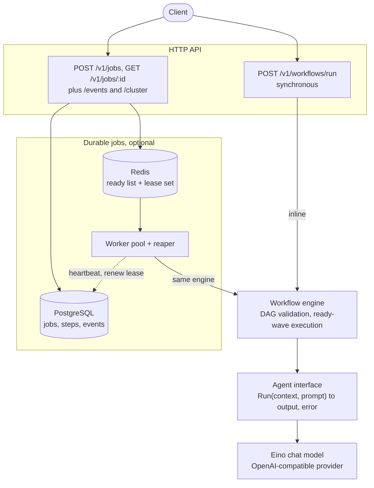
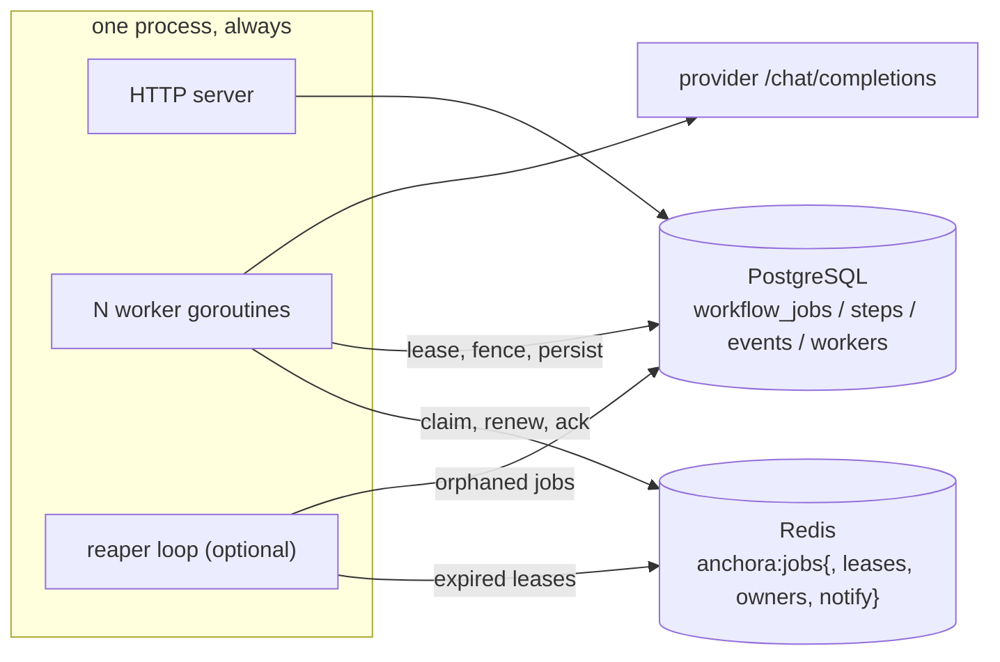

# ANCHORA — project documentation

This document is the complete reference for Anchora: the architecture, every package in
the codebase, the storage and queue designs, the HTTP API, configuration, testing, and
the reasoning behind the major architecture decisions. The [README](../README.md) owns
the operational quick start; this document owns the how and the why.

---

## Contents

1. [What Anchora is](#1-what-anchora-is)
2. [Repository layout](#2-repository-layout)
3. [Core concepts](#3-core-concepts)
4. [Architecture](#4-architecture)
5. [Package reference](#5-package-reference)
   - 5.1 [cmd/anchora](#51-cmdanchor)
   - 5.2 [lib/config](#52-libconfig)
   - 5.3 [lib/workflow](#53-libworkflow)
   - 5.4 [lib/einoagent](#54-libeinoagent)
   - 5.5 [lib/httpapi](#55-libhttpapi)
   - 5.6 [lib/jobs](#56-libjobs)
6. [Data model](#6-data-model)
7. [Redis queue design](#7-redis-queue-design)
8. [Consistency and failure semantics](#8-consistency-and-failure-semantics)
9. [HTTP API reference](#9-http-api-reference)
10. [Configuration reference](#10-configuration-reference)
11. [Deployment](#11-deployment)
12. [Testing strategy](#12-testing-strategy)
13. [Architecture decisions](#13-architecture-decisions)
14. [Glossary](#14-glossary)

---

## 1. What Anchora is

Anchora runs **workflows made of dependent agent calls**. A user describes steps; each
step names an agent, carries a prompt, and may depend on other steps. Anchora:

1. validates that the dependencies form a DAG (rejecting cycles, unknown or duplicate
   dependencies, and malformed steps before anything runs),
2. executes the steps **wave by wave** — every wave runs all steps whose dependencies
   have already succeeded, concurrently,
3. renders each prompt just before its wave, interpolating earlier step outputs via
   `{{steps.<id>.output}}`,
4. retries failing steps with linear backoff, and skips everything downstream of a
   permanent failure.

Workflows run in two shapes against the **same engine**:

- **Synchronously**, inside the HTTP request that submitted them
  (`POST /v1/workflows/run`).
- **Asynchronously**, as durable jobs: the workflow is recorded in PostgreSQL, its ID is
  pushed onto a Redis queue, and a cluster of workers claims and executes them. The job
  path survives worker crashes (leases + reapers), never re-runs a step that already
  succeeded (fencing + resume), and streams progress as Server-Sent Events.

Agents are the single abstraction the engine deals with: a three-method-free interface,
`Run(context.Context, string) (string, error)`. The executable wires named agents to
[Eino](https://github.com/cloudwego/eino) chat models speaking plain OpenAI
chat-completions against any compatible provider (Hugging Face's router by default).

- Language/platform: Go 1.25, no CGO.
- Module: `github.com/sagnikc395/anchora`.
- License: MIT.
- Direct dependencies: `github.com/cloudwego/eino` (+ its openai model adapter),
  `github.com/go-chi/chi/v5`, `github.com/jackc/pgx/v5`, `github.com/redis/go-redis/v9`,
  `gopkg.in/yaml.v3`.
- Backends: PostgreSQL (state, events, worker registry), Redis (queue dispatch and lease
  bookkeeping). Both are optional; without them only the synchronous API exists.

---

## 2. Repository layout

```
anchora/
├── cmd/anchora/
│   └── main.go            # process entry point: config → agents → jobs → HTTP server
├── lib/
│   ├── config/
│   │   └── config.go      # YAML configuration, defaults, fail-fast validation
│   ├── workflow/
│   │   └── workflow.go    # the engine: DAG validation, waves, retries, rendering
│   ├── einoagent/
│   │   └── agent.go       # workflow.Agent adapter over an Eino OpenAI-compatible model
│   ├── httpapi/
│   │   └── router.go      # Chi router: sync run API + durable job API + SSE + cluster
│   └── jobs/
│       ├── jobs.go        # jobs.Service: submit, worker loop, reaper, fencing, resume
│       ├── store.go       # PostgreSQL store (jobs, steps, events, workers) + schema
│       └── queue.go       # Redis queue (ready list, lease set, owners, notify) + Lua
├── tests/                 # black-box test package (one package for everything)
│   ├── workflow_test.go   # engine semantics
│   ├── router_test.go     # sync HTTP API
│   ├── jobs_test.go       # job API over in-memory fakes
│   ├── agent_test.go      # Eino adapter over a fake transport
│   ├── config_test.go     # config defaults and validation
│   ├── backend_integration_test.go  # real PostgreSQL + Redis (skipped without URLs)
│   └── helpers_test.go    # shared stubs (countingAgent, registry)
├── examples/workflow.json # the two-step workflow used in the README
├── config.yaml            # checked-in, loadable-by-default configuration
├── .env.example           # every environment variable Anchora reads
├── docker-compose.yml     # PostgreSQL + Redis (+ the app behind an `app` profile)
├── Dockerfile             # multi-stage build → distroless static non-root image
├── Taskfile.yml           # go-task target surface (run, build, test, check, …)
└── go.mod / go.sum
```

The layering rule worth internalising: **`lib/workflow` imports nothing from the other
packages.** `einoagent`, `httpapi`, and `jobs` all depend on `workflow`; `cmd/anchora`
depends on everything and is the only place the concrete provider adapter is wired in.

| Layer | Depends on |
| --- | --- |
| `cmd/anchora` | config, einoagent, httpapi, jobs, workflow |
| `lib/httpapi` | jobs, workflow |
| `lib/jobs` | workflow |
| `lib/einoagent` | workflow (interface only), eino |
| `lib/config` | nothing project-local |
| `lib/workflow` | nothing project-local |

---

## 3. Core concepts

**Workflow** — an ordered set of steps whose `depends_on` edges form a DAG. A workflow
is a *plan*: it is validated once (`NewWorkflow`) and can be executed many times; a run
holds no state on the plan itself.

**Step** — one agent call. Four fields: `id` (unique), `agent` (a *name*, resolved
before execution), `prompt` (may reference upstream outputs), `depends_on` (the steps
that must succeed first). At the HTTP boundary the agent is always a string; concrete
agents are attached either by the router (sync path) or the worker (job path).

**Agent** — `Run(context.Context, string) (string, error)`. That is the entire
contract: one prompt in, one text out. Everything observable (retries, outputs, event
payloads) is built on that.

**Wave** — a maximal set of steps whose dependencies all succeeded in the current run.
Waves execute fully concurrently; the next wave begins only when every step of the
current wave has reached a terminal state. Inside a wave steps are processed in ID
order so behaviour is deterministic.

**Retry** — configured globally (`max_retries`, `retry_delay_ms`). `max_retries`
counts attempts *after* the first call. Backoff is linear: retry *n* waits
n × `retry_delay_ms`. Retries respect context cancellation.

**Skip cascade** — when a step fails, every step that can no longer run is marked
`skipped` with error `dependency failed`, transitively to the end of the DAG (the
skip loop iterates to a fixed point).

**Resume** — a run can be seeded with previously succeeded step results
(`Options.Resume`). Seeded steps are not re-executed; their outputs are replayed into
prompt interpolation. This is what makes a redelivered job cheap.

**Step statuses** — `pending`, `running`, `succeeded`, `failed`, `skipped` are the
persisted states; `retrying` is an in-memory execution state visible only through the
`OnStepState` callback, never written to the store.

| Status | Meaning | Persisted? |
| --- | --- | --- |
| `pending` | not started yet | yes |
| `running` | an agent call is in flight | yes |
| `retrying` | failed once, about to retry | no (in-memory) |
| `succeeded` | output available | yes |
| `failed` | exhausted retries (or failed irrecoverably) | yes |
| `skipped` | a dependency did not succeed | yes |

**Prompt interpolation** — the placeholder `{{steps.<id>.output}}`, matched by
regex `{{steps\.([A-Za-z0-9_-]+)\.output}}`. A reference to a step that has not
succeeded is a *render error*: the step fails with `output for step "x" is
unavailable` rather than being run with a blank or partial prompt. Rendered prompts
are trimmed. There is deliberately no other templating machinery.

**Event log** — every job has an append-only, monotonic-ID event log in PostgreSQL
(`workflow_events`). The SSE endpoint streams from it; `Last-Event-ID` resumes a
dropped stream; `job.completed` and `job.dead_lettered` are terminal events that close
the stream.

---

## 4. Architecture

Two entry points, one engine:



**Synchronous path.** The router decodes the body (≤ 1 MiB, unknown fields rejected),
resolves agent names to concrete agents, builds a `workflow.Workflow` (validation
errors → 400), and runs it inside the request. A step failure is a 502 carrying the
partial results; success is a 200 with one result per step in declaration order.

**Asynchronous path.** The router decodes the same body, but steps keep only agent
*names*. `jobs.Service.Submit` re-validates the graph, generates a 128-bit job ID,
records job + steps + all-pending results in one transaction, appends a `job.queued`
event, and pushes the ID onto the Redis queue — returning `202` immediately. A worker
(`RunWorker`) loops `Queue.Claim → process`; `process` takes a PostgreSQL lease on the
job, renames it `running`, then runs the **same engine**, wiring each step's agent
through a *fenced agent* that re-checks ownership before every agent call. Step results
are persisted and streamed as events as they land; the job finishes with a fenced
write, the queue entry is acked, and the event stream closes on the terminal event.



One process is a complete deployment. Several processes pointed at the same PostgreSQL
and Redis form a cluster: the queue arbitrates *who looks at a job next*, the store
arbitrates *who is allowed to run it*, and both write paths converge because every
worker write is fenced on the PostgreSQL lease.

---

## 5. Package reference

### 5.1 cmd/anchora

`cmd/anchora/main.go` (~200 lines) is the only `main` in the repository. Its job is
wiring and shutdown; all logic lives in `lib/`.

Startup sequence, in order:

1. `config.Load(path)` — the `-config` flag (default `config.yaml`).
2. `buildAgents` — constructs **every** configured agent up front, so a bad model ID or
   a missing token environment variable is a startup failure, not a failed workflow
   step later.
3. If `async.enabled`: `newJobService` connects the `jobs.Store` (PostgreSQL) and
   `jobs.Queue` (Redis), wires a `jobs.Service` with the configured lease/heartbeat/
   dead-letter settings and the agent registry; `startWorkers` then launches
   `async.WorkerCount()` goroutines (each with its own `jobs.NewWorkerID()`), plus the
   reaper loop if `async.reaper` allows it. All goroutines are tracked in one
   `sync.WaitGroup`.
4. An `http.Server` with `ReadHeaderTimeout` 10 s (headers only — the SSE endpoint may
   stream for the lifetime of a job, so the body/response are deliberately unbounded)
   serving `httpapi.NewRouterWithJobs`.

Shutdown, ordered:

1. `SIGINT`/`SIGTERM` are converted into context cancellation (`signal.NotifyContext`).
2. `server.Shutdown` drains HTTP connections with a hard 15 s budget (`shutdownGrace`).
3. Worker goroutines are waited on for whatever remains of the budget. A worker exiting
   due to cancellation *unregisters* itself and, for in-flight jobs, releases/requeues
   through the abandon path — so a rolling restart does not wait out the visibility
   timeout. If workers do not drain in time, the log line is explicit and the expired
   leases take over (the normal reaper path).
4. Backend connections are closed (Redis first, then PostgreSQL).

Notes worth knowing:

- `sync.WaitGroup` + channel close is used to wait on workers with a timeout; the
  process does not force-kill anything — a stuck worker loses its lease eventually.
- `httpapi.Options` (retries) is applied both to the sync router and, as
  `workflow.Options`, to the job service, so the two paths retry identically.

### 5.2 lib/config

`lib/config/config.go` loads YAML and converts it into typed settings. Two ideas shape
it:

- **Milliseconds only.** The file has no unit suffixes; accessor methods
  (`Async.Lease()`, `Async.Heartbeat()`, …) multiply by `time.Millisecond` and apply
  defaults, so the rest of the code never sees an int again.
- **Secrets live in the environment, named by the file.** `token_env`, `database_url_env`,
  and `redis_url_env` never contain values; they contain the *name* of an environment
  variable, with defaults `HF_TOKEN`, `DATABASE_URL`, `REDIS_URL`.

Sections: `server` (listen address, default `:8080`), `workflow` (retry settings),
`async` (durable backend), `agents` (a map of name → agent). Validation is fail-fast
and runs at load:

- every numeric field must be non-negative,
- `heartbeat_ms` must be strictly less than `lease_ms` when both are set — a heartbeat
  slower than its lease would let a lease expire before it is ever renewed, so it is
  rejected outright rather than tolerated,
- when `async.enabled` is true, **both** backend URLs must resolve from the
  environment *at load time*,
- every agent needs a non-empty name and `model_id`.

The checked-in `config.yaml` (async disabled, no agents) must always load — a test
(`TestCheckedInConfigLoads`) pins that, since the README instructs new users to start
with it.

Derived defaults (also mirrored in `lib/jobs.Config` accessors):

| Setting | Default |
| --- | --- |
| `server.address` | `:8080` |
| async: `lease_ms` | 30 s |
| async: `heartbeat_ms` | lease / 3 |
| async: `worker_ttl_ms` | 4 × lease |
| async: `reaper_interval_ms` | 5 s |
| async: `reclaim_batch` | 100 |
| async: `workers` | 1 (a configured zero still starts one) |
| async: `reaper` | `true` (a `*bool`; absent means on) |
| agent: `base_url` | `https://router.huggingface.co/v1` |
| agent: `token_env` | `HF_TOKEN` |

An agent's `timeout_ms: 0` leaves the model's HTTP client without a timeout, and
`max_tokens: 0` omits the field from the provider request entirely — both are
meaningful "provider default" choices, not bugs.

### 5.3 lib/workflow

`lib/workflow/workflow.go` (~340 lines) is the engine and the innermost package. It
exports a deliberately small surface: `Agent`, `Step`, `StepResult`, `Status`,
`Options`, `Workflow`, `WorkflowError`.

**Validation (`NewWorkflow`).** Rejects in this order: negative retry options, empty
step list, steps missing an id/agent/prompt, duplicate step IDs, invalid dependencies
(empty or self), unknown dependencies, duplicate dependencies on the same step, and
cycles. Cycle detection is Kahn's algorithm (in-degree countdown → topological count),
chosen comment-flagged as "the cheapest cycle test available" for graphs of this size.
The validated plan copies the step slice, so callers may mutate their input afterwards
without corrupting a reusable workflow.

**Execution (`Run`).** The loop over `remaining` (a map of not-yet-terminal steps):

1. `readyWave` removes and returns every step whose dependencies all succeeded — in ID
   order, so a run is deterministic regardless of Go's map iteration order.
2. **Every prompt in the wave is rendered synchronously before any agent goroutine
   starts.** This is the race-avoidance heart of the engine: `results` is a plain map
   mutated by the collection loop below, and no goroutine reads it while that loop
   runs. A per-wave test (`TestWorkflowRendersConcurrentWaveWithoutRacing`) runs under
   `-race` to pin the pattern.
3. Render failures become immediate `failed` results (no agent call) — that keeps an
   unrenderable prompt from retrying pointlessly.
4. One goroutine per ready step pushes its `StepResult` into a buffered channel; the
   collection loop receives exactly `len(ready)` results, stores them, and calls
   `OnStepState` once per result. `OnStepState` runs on that collector goroutine, so
   implementations must not block for long.
5. `skipBlocked` iterates to a fixed point, marking every step whose dependency chain
   hit a non-`succeeded` result as `skipped` transitively.
6. Loop until `remaining` is empty — or until no step is ready (which cannot happen for
   a validated acyclic graph with skip-cascading in place, but `Run` breaks out anyway
   and reports leftover steps as `skipped` / `workflow did not run` as a safety net).

Results are returned **in declaration order** regardless of execution timing, which
makes responses stable for clients. The returned error on failure is a
`*WorkflowError{StepID, Err}` naming the first failed step, wrapping the step's error
(unwrappable, so `errors.Is`/`errors.As` work); the partial results are returned
alongside the error by design.

**Retries (`runStep`).** A loop around `agent.Run`: success short-circuits; failure
with attempts already at `max_retries` becomes `failed`; otherwise the attempt counter
increments, status becomes `retrying`, and the worker waits for a context-aware sleep
of `attempts × RetryDelay` — cancellation converts to `failed` with the context error,
never lost. `Attempts` in the result therefore counts *retries used*, not total calls.

**Resume.** `Options.Resume` seeds succeeded results from a prior delivery. Unknown or
non-succeeded resume entries are ignored; a failed prior result is re-run (a failed
step may have been transient). Downstream prompts interpolate resumed outputs exactly
as fresh ones.

**Rendering (`renderPrompt`).** Regex substitution; a missing or non-succeeded
reference aborts rendering with an error rather than substituting empty text; the
result is `strings.TrimSpace`d.

**Bounded-visibility invariants.** The engine never imports jobs, httpapi, or config.
The jobs package depends on `Options.Resume` and `OnStepState` — those two hooks are
the engine's entire observability/lifecycle surface, which keeps the engine reusable
outside Anchora.

### 5.4 lib/einoagent

`lib/einoagent/agent.go` (~110 lines) adapts Eino's OpenAI-compatible `ChatModel` to
`workflow.Agent`. One agent = one model = one system instruction.

- `New(ctx, Config)` validates eagerly: non-empty name and `model_id`; reads the token
  from `TokenEnv` (default `HF_TOKEN`) and **errors at construction if unset**; applies
  `BaseURL` (default `https://router.huggingface.co/v1`, the Hugging Face Inference
  Providers router); `max_tokens > 0` becomes a pointer, otherwise the field is
  omitted; `Timeout` and a injectable `HTTPClient` (the test seam) pass through to
  `openai.NewChatModel`.
- `Run` builds `[system instruction?, user prompt]` and calls `Generate`. Two
  rejections: nil/uninitialized agent ("Eino agent is not initialized"), and an empty
  or whitespace-only completion — a step that produced no text has nothing to pass
  downstream, and failing it (so retries can kick in) is treated as the right default.
- Errors are wrapped with `fmt.Errorf("generate with Eino chat model: %w", err)`.

The wire contract is plain `POST {base_url}/chat/completions` with a bearer token, so
anything OpenAI-compatible works (vLLM, Ollama's OpenAI shim, OpenRouter, …). The
agent tests exercise real request/response JSON through a fake
`http.RoundTripper` — including checking `Authorization: Bearer …`, the model field,
system/user roles, `max_tokens`, and empty-completion rejection.

### 5.5 lib/httpapi

`lib/httpapi/router.go` (~260 lines) exposes the engine over HTTP with Chi.

**Shared middleware:** `middleware.RequestID`, `middleware.Recoverer` — request IDs
arrive for free and panics become 500s instead of dropped connections. There is no
logging middleware, body-size limit middleware (that is inline), or CORS: deliberate
simplicity, listed in `docs/TODO.md`.

**Body handling (`decodeRunRequest`):** `http.MaxBytesReader` at 1 MiB
(`maxRequestBytes`), `DisallowUnknownFields` — a typo'd step key is a 400, not a
silently ignored field. Malformed JSON, oversize bodies, and unknown fields all become
the same JSON error `{"error":"invalid JSON request"}`.

**Routes:**

| Route | Handler | Notes |
| --- | --- | --- |
| `GET /healthz` | inline | Always available; pure liveness. |
| `POST /v1/workflows/run` | `runHandler` | Sync execution; see below. |
| `POST /v1/jobs` | `submitJobHandler` | Registered only with a job backend; `202`. |
| `GET /v1/jobs/{id}` | `getJobHandler` | `Job` JSON; `404` on miss. |
| `GET /v1/jobs/{id}/events` | `eventsHandler` | SSE stream; see below. |
| `GET /v1/cluster` | `clusterHandler` | Queue depth + worker roster. |

Job routes are **omitted entirely** when the service is nil (async disabled) — a test
pins that they 404 instead of erroring confusingly.

**`runHandler` (sync).** Resolves each step's agent name against the
`AgentResolver` (`unknown agent: <name>` → 400), builds the workflow (validation →
400), runs it in `r.Context()`. Mapping the outcome to status codes:

| Outcome | Status | Body |
| --- | --- | --- |
| success | 200 | full `StepResult` list |
| `*WorkflowError` | `502 Bad Gateway` | partial results *instead of* an error string — deliberately, and tested: "the request was valid, the upstream agent failed" |
| anything else | 500 | `{"error": …}` |

**`submitJobHandler`.** Same decoding/validation discipline, but steps carry agent
*names*; the service re-validates through `Submit`. `400` on any invalid input; `202`
with the created `Job` on success.

**`eventsHandler` (SSE).** Guards: job must exist (`404`) and the writer must support
flushing (`500` on 1.0-style non-flushable writers). `Last-Event-ID` semantics: absent
on a first connect; present-but-unparseable (or < 0) is a `400` returned **as JSON
before any SSE framing** (pinned by test, so clients get a real error not a
half-opened stream). The handler then loops: `service.Events(after)` → write each
event as `id:/event:/data:` frames → `Flush()` → stop when a terminal event
(`job.completed` / `job.dead_lettered`) was among them; otherwise sleep on a
500 ms ticker (`pollInterval`) or the request context. The 500 ms get-to-DB polling
design and its trade-off (watchers scale with connections; each closed stream is
cheap) are covered in [§8](#8-consistency-and-failure-semantics) and the
architecture decisions.

**`clusterHandler`.** `service.Stats` → `Stats{queue_ready, queue_in_flight, workers[]}`.

**Errors.** All error bodies are `{"error": message}` with an appropriate status;
`writeJSON` sets `application/json` and ignores encode errors (bodies are maps or
structs that always encode).

### 5.6 lib/jobs

Three files: `jobs.go` (service logic), `store.go` (PostgreSQL), `queue.go` (Redis).

#### 5.6.1 jobs.go — the service

Defines the two backend interfaces (`JobStore`, `JobQueue`) plus types (`Job`,
`Event`, `Step`, `Stats`, `WorkerInfo`, `Config`) and the orchestration: submission,
worker loop, reaper, per-delivery lifecycle, and the correctness machinery.

**`Config` defaults** (applied in accessor methods; zero values are meaningful):
lease 30 s; heartbeat = min(given, valid) or lease/3; reaper interval 5 s; worker TTL
4 × lease; reclaim batch 100.

**Timeouts that outlive cancellation** (constants): job finish 10 s; step write 5 s;
worker unregister 5 s. These use `context.WithoutCancel` so a shutdown or lease loss
mid-write still records what happened, fenced as usual.

**`Submit`.** Resolve agent names → re-validate the whole workflow (so an invalid DAG
or unknown agent is a `400` before anything durable happens) → `NewID` (128-bit
random hex) → `Store.Create` (transaction: job + steps + all-pending results) →
`AppendEvent(job.queued)` → `Queue.Push`. The failure ordering is deliberate: if the
push fails after the job is durable, the job would sit undispatched forever (the store
reaper only looks at jobs that *have* a lease), so the submit path fails it on the
spot (`FinishJob` with empty owner — matching an unclaimed job) and surfaces the
error, rather than leaving an uncancellable zombie.

**`RunWorker`.** Register in the worker registry → start a heartbeat goroutine
(extend-free: it only updates `last_heartbeat_at` and flushes the `jobs_claimed`
counter accumulated between beats) → claim loop. The claim loop:

```
id, err := Queue.Claim(owner, lease)
- claim error    → exponential backoff 100 ms → 5 s cap ("a broken queue must not spin")
- id == ""       → idle wakeup, loop immediately
- id != ""       → process(ctx, workerID, id)
```

Plus a deferred unregister (5 s detached budget). On ctx cancellation the worker exits
with the context error; in-flight processing has already finished or abandoned.

**`RunReaper`.** Every `reaperInterval`: 

1. `Queue.Reclaim(batch)` — expired Redis leases re-pushed onto the ready list; each
   recovery appends a `job.reclaimed` event with the reason.
2. `Store.ReclaimExpiredJobs(grace = one full lease, batch)` — "the two reapers cover
   each other": handles jobs whose queue entry vanished entirely (flush/failover) but
   deliberately waits an extra lease period so the cheaper queue sweep handles the
   ordinary case first and the two sweeps don't collide; recovered jobs are re-pushed
   and evented (`reason: store lease expired`).
3. `PruneWorkers(ttl)` — silent workers leave the registry.

Running the reaper on every node is safe and expected (see decisions), and `${async.reaper: false}` enables a dedicated reaper-only deployment.

**`process` — one delivery, start to conclusion.**

```
ClaimJob              → attempts++ , status running, lease set (POSTGRES authority)
  not claimable       → duplicate delivery → drop it, ack. (normal under at-least-once)
  attempts > max      → deadLetter (fenced FinishJob → failed) + job.dead_lettered + ack
AppendEvent(running)  → {status: running, worker, attempt}
holdLease (goroutine) → every heartbeat: ExtendLease (store) then Queue.Extend (Redis);
                        either refusing → cancel(run) with ErrLeaseLost
runJob                → the engine, fenced, resumed
  infra error         → abandon (below). never finishes the job as failed.
  job error           → persist every result (UpdateStep per result, fenced),
                        FinishJob (fenced; !held → another owner exists, discard outcome),
                        AppendEvent(job.completed), ack
```

`FinishJob` returning `false` (lease already reclaimed between heartbeats) is treated
exactly as designed: **drop the local outcome rather than fight the new owner.**

**`holdLease`.** Ticker at `heartbeat()`. On each beat it extends the store lease then
the queue lease (recoverable transient errors cause a skip-and-retry next beat — the
lease still has most of its window). If either reports "not held anymore", the run
context is cancelled with `ErrLeaseLost`, so a superseded worker stops burning agent
calls — the seconds-behind new owner cannot double-spend the model.

**`runJob` — two failure classes.** The return is `(results, jobErr, infraErr)`:

- *workflow failure* (terminal): agent produced a failure, unknown agent in a
  persisted job (config error but not a retry loop), job vanished from the store, or
  any validation error. Recorded as `failed`.
- *infrastructure failure* (retryable): lost lease, shutdown cancellation, or a stuck
  step write. The job is **abandoned**, not failed — release + requeue so a healthy
  worker retries it immediately.

Distinguishing context cases: `context.Cause` on the run context decides — lease-loss
cause → infra; parent shutdown (ctx.Err) → infra; a plain `context.Canceled` that
isn't the run's own → also infra. The fence record (`leaseFence.lost`) covers the case
where a step claim was refused *before* the heartbeat could notice, so the outcome is
classified as lease loss (retried elsewhere) rather than a workflow failure
(terminal).

**`fencedAgent` — the per-step fence.** Every step's agent in a job run is wrapped:

```go
ClaimStep(jobID, stepID, owner)   // refused if the step already succeeded (resume)
                                  // refused if the worker no longer owns the job
inner.Run(...)                    // only reached when the claim holds
```

Downside: one extra `UPDATE` per step call. Upside: effectively at-most-once per step —
a worker that was replaced mid-job cannot spend a second *inference* on a step the new
owner is already doing. Losses set a fence flag consumed by the classification above.

**`resumable` / OnStepState wiring.** On a fresh delivery, succeeded results from the
store feed `Options.Resume`, and `job.resumed` is appended with the count. Live
results stream out through `OnStepState`: persisted immediately (detached 5 s context,
still fenced), and each is appended as a `step.completed` event — both survive a
concurrent shutdown/lease loss by design.

**`abandon`.** Appends `job.abandoned` (worker + reason). If the cause is lease loss,
it touches nothing else — the new owner already owns the queue entry; otherwise
`ReleaseJob` (store, fenced) then `Queue.Requeue` (immediately claimable again).

**IDs.** `NewID` = 16 random bytes hex-encoded. `NewWorkerID` = `hostname-pid-8hex`,
unique across the cluster and readable in `/v1/cluster`.

#### 5.6.2 store.go — PostgreSQL

`pgxpool`-backed. `NewStore` connects, pings, and applies the schema (additive:
`CREATE TABLE IF NOT EXISTS` / `ADD COLUMN IF NOT EXISTS`), so a fresh database is set
up automatically and an old one gets new columns — see
[§6](#6-data-model) for the four tables.

Ownership rules implemented as SQL (details in the file):

| Operation | Fencing rule |
| --- | --- |
| `ClaimJob` | refuses terminal status; refuses live `owner` unless it is the same worker; sets status `running`, owner, `lease_expires_at = now()+lease`, bumps `attempts`, `started_at` via COALESCE (first delivery only) |
| `ExtendLease` | only for `owner` and status `running`; returns `false` otherwise |
| `FinishJob` | only for `owner`; special `owner=""` matches an *unclaimed* job (submit-time enqueue failure) |
| `ReleaseJob` | only for `owner`, status `running`; back to `pending`, unowned |
| `ReclaimExpiredJobs` | status `running` + lease expired by ≥ grace; `FOR UPDATE SKIP LOCKED` batch; back to `pending`, unowned; returns IDs to re-push |
| `ClaimStep` | join-fenced on job owner; refuses already-succeeded steps (resume); sets step `running`/`started_at` |
| `UpdateStep` | join-fenced on job owner; `finished_at` stamped only for terminal step statuses |

- `Get` reconstructs the full `Job` (steps in `ordinal` order). Missing job = nil, nil.
- `Create` is a single transaction: job + every step, so a job is never visible
  without its steps.
- Events: `AppendEvent` never fails a job ("events are advisory"), `Events(after)`
  orders by monotonic ID for SSE resume.
- Worker registry: upsert on `RegisterWorker` (restart = reset start/heartbeat time),
  `HeartbeatWorker` adds the since-last-beat claim count, `UnregisterWorker` deletes
  clean shutdowns, `PruneWorkers` removes silence, `Workers(ttl)` lists the live roster
  for `/v1/cluster`.

#### 5.6.3 queue.go — Redis

Four keys under the queue name (default `anchora:jobs`):

| Key | Type | Purpose |
| --- | --- | --- |
| `anchora:jobs` | LIST | ready job IDs; LPUSH + RPOP keeps FIFO order |
| `anchora:jobs:leases` | ZSET | in-flight job ID → lease deadline (unix ms) |
| `anchora:jobs:owners` | HASH | in-flight job ID → owner worker ID |
| `anchora:jobs:notify` | LIST | wakeup hints for parked workers |

Five Lua scripts make every transition atomic across those keys (see the file for the
sources): `claim` (RPOP + ZADD deadline + HSET owner), `push` (LPUSH + notify), `ack`
(ZREM + HDEL — the job leaves the queue), `requeue` (release + immediately claimable),
`extend` (owner-fenced ZADD; returning 0 means "you were replaced"), and `reclaim`
(ZRANGEBYSCORE expired → re-push each + notify once).

Claim otherwise: on an empty ready list the worker parks on `BRPop notify` for at most
1 s, so a `Push` wakes it instantly while a stolen hint only costs a bounded sleep
(the claim script remains the source of truth). `Depth` = `LLEN ready` + `ZCARD
leases` for `/v1/cluster`.

Persistence posture: Redis holds *bookkeeping only*. Losing it can lose at-most-once
dispatch state (a claimed lease vanished), and the store-side reaper recovers those
jobs on the next sweep — that is precisely what the second reaper exists for. The
compose file enables AOF with per-second fsync anyway (§11), because avoiding a whole
sweep's delay for routine restarts is still worth it.

---

## 6. Data model

```sql
workflow_jobs (
  id TEXT PRIMARY KEY,
  status TEXT NOT NULL,                    -- pending|running|succeeded|failed
  created_at TIMESTAMPTZ NOT NULL,
  started_at TIMESTAMPTZ,                  -- COALESCE'd: first delivery only
  finished_at TIMESTAMPTZ,
  attempts INTEGER NOT NULL DEFAULT 0,     -- delivery count (added column)
  owner TEXT,                              -- live lease holder, authoritative
  lease_expires_at TIMESTAMPTZ,            -- the store's half of the lease
  error TEXT NOT NULL DEFAULT '',
  updated_at TIMESTAMPTZ NOT NULL DEFAULT now()
);
CREATE INDEX workflow_jobs_lease ON workflow_jobs(status, lease_expires_at);

workflow_steps (
  job_id TEXT NOT NULL REFERENCES workflow_jobs(id) ON DELETE CASCADE,
  id TEXT NOT NULL,
  ordinal INTEGER NOT NULL,                -- declaration order, drives Get ordering
  agent TEXT NOT NULL,                     -- agent name (indirection survives restarts)
  prompt TEXT NOT NULL,
  depends_on JSONB NOT NULL DEFAULT '[]',
  status TEXT NOT NULL,                    -- pending|running|succeeded|failed|skipped
  attempts INTEGER NOT NULL DEFAULT 0,
  output TEXT NOT NULL DEFAULT '',
  error TEXT NOT NULL DEFAULT '',
  owner TEXT, added,                       -- step claim holder
  started_at TIMESTAMPTZ, added,
  finished_at TIMESTAMPTZ, added,
  PRIMARY KEY(job_id,id)
);

workflow_events (
  id BIGSERIAL PRIMARY KEY,               -- monotonic → SSE resume
  job_id TEXT NOT NULL REFERENCES workflow_jobs(id) ON DELETE CASCADE,
  type TEXT NOT NULL,                      -- event.* strings (§9)
  data JSONB NOT NULL,
  created_at TIMESTAMPTZ NOT NULL DEFAULT now()
);
CREATE INDEX workflow_events_job_id_id ON workflow_events(job_id, id);

workflow_workers (
  id TEXT PRIMARY KEY,                     -- hostname-pid-8hex
  hostname TEXT NOT NULL DEFAULT '',
  pid INTEGER NOT NULL DEFAULT 0,
  queue TEXT NOT NULL DEFAULT '',
  started_at TIMESTAMPTZ NOT NULL DEFAULT now(),
  last_heartbeat_at TIMESTAMPTZ NOT NULL DEFAULT now(),
  jobs_claimed BIGINT NOT NULL DEFAULT 0
);
CREATE INDEX workflow_workers_heartbeat ON workflow_workers(last_heartbeat_at);
```

Indices line up with the actual queries: jobs are reclaimed by

`(status='running', lease_expires_at <= now()-grace)`; events stream by

`(job_id, id)`; workers prune/roster by `last_heartbeat_at`.

Retention: **no TTL or archival policy exists**. Terminal jobs, their steps, and their
events accumulate forever — a deliberate simplification tracked in `docs/TODO.md`.

---

## 7. Redis queue design

The queue is intentionally *not* `BLPOP` on a plain list. It is two structures plus a
parking lot:

```
push:  LPUSH ready:j            LPUSH notify (hint, LTRIM to 255)
claim: RPOP ready:j  →  ZADD leases:j deadline, owner → HASH owners
extend: (owner-fenced) ZADD leases:j new deadline
ack:    ZREM leases:j, HDEL owners:j            -- the job leaves the queue
requeue: ZREM+HDEL then LPUSH ready:j (again hint)
reclaim: ZRANGEBYSCORE leases -inf now → for each: ZREM/HDEL/LPUSH ready → notify
```

The ready list keeps FIFO fairness (LPUSH/RPOP). The lease set + owner hash let a
reaper reclaim exactly the expired set without blocking claims; owner-checking extends
prevents a resurrected old owner from overwriting a new one's deadline. The `notify`
hint list caps at 255 entries (hints are advisory; the claim script is authoritative).

At-least-once emerges from the pair (claim-is-move, ack-is-removal): a crash between
the two is visible in the lease set with an expiring deadline, no job vanishes, no job
is *guaranteed* to run exactly once — sequencing or an ack can always be lost midway.

---

## 8. Consistency and failure semantics

The three sentences at the top of `jobs.go` carry the whole design; here they are with
the mechanism behind each.

**Delivery is at-least-once.** A claimed job is *moved* (RPOP + ZSET/HASH insert) in
one atomic script; the acknowledgement *removes* it. Any crash in between leaves the
job discoverable (lease expiry → reclaim → redelivery). A redelivery is cheap by
construction: the duplicate `ClaimJob` refuses and the worker acks, no agent call.

**Execution is effectively at-most-once per step.** The acknowledgement of a *step* is
a per-step claim (`ClaimStep`) made against the authoritative owner state immediately
before each agent call. Two racing deliveries cannot both run the same step: one wins
the step claim. The remaining at-least-once window per step is the narrower one
between that claim and an agent completing — bounded by one heartbeat's worth of
supervision.

**A redelivered job resumes rather than restarts.** Succeeded steps are replayed from
the store (`Options.Resume`) into the engine; the run then redoes only the still-pending
prefix of the DAG. Crash recovery therefore costs only the work that was actually
lost (that exact property is an integration test:

`TestIntegrationCrashRecoveryResumesJob` — worker dies after finishing step one,
reaper requeues, live worker resumes, and the counting agent asserts the first prompt
ran 0 times overall).

**Fencing.** Every write a worker makes while running a job is conditional on it still
holding the PostgreSQL lease:

- `FinishJob` — the outcome is dropped wholesale if the lease is gone.
- `UpdateStep` / `ClaimStep` — jointly fenced on `workflow_jobs.owner`.
- `ReleaseJob` / `ExtendLease` — owner-fenced.

Redis-side bookkeeping is owner-fenced too (`extendScript` returns 0 to a stale
owner), but the PostgreSQL row is the *authority*: the queue decides dispatch order,
the store decides progress. A partitioned worker that "thinks" it still owns a job can
neither overwrite the new owner's step outputs nor finalise the job incorrectly.

**Two reapers, deliberately asymmetric.** The Redis sweep (`Queue.Reclaim`) handles
the ordinary case of a dead worker. The store sweep (`ReclaimExpiredJobs`) handles the
worst case of a *lost queue entry* (flush, failover without persistence). The store
sweep's `grace` parameter — applied as one full lease in `reap()` — holds it back one
lease period so the cheap sweep goes first. Both are atomic (Lua / `FOR UPDATE SKIP
LOCKED`) and safe to run from every node concurrently; hence `reaper: true` is a safe
default everywhere.

**Dead-letter.** `async.max_attempts` (default 3, 0 = unlimited) caps deliveries. A
job whose *delivery count* exceeds the limit is finished as `failed` with
`exceeded N delivery attempt(s)` and can never be claimed again (`ClaimJob` refuses
terminal statuses). This guards against a poison job that, say, crashes every worker
that touches it.

**Cancellation vs loss.** Losing a lease is not "failing" the job: the old owner
abandons silently (no ReleaseJob/Requeue — the new owner already owns the entry) and
the new owner continues from the store's replayed state.

**Startup validation is fail-fast.** Every misconfiguration (bad heartbeat vs lease,
missing backend URLs, missing token, agent without model) aborts startup instead of
degrading at runtime; the config test-suite and main's agent-construction-annotated
error messages make each failure precise at the point of cause.

---

## 9. HTTP API reference

Base: whatever `server.address` points at (default `:8080`), plain HTTP, JSON. Bodies
are capped at 1 MiB; unknown JSON fields are rejected. All error bodies are
`{"error": "message"}`.

| Method | Path | Available | Success | Errors |
| --- | --- | --- | --- | --- |
| GET | `/healthz` | always | `200 {"status":"ok"}` | — |
| POST | `/v1/workflows/run` | always | `200` step results | `400` invalid body/unknown agent/invalid graph · `502` step failed (body = partial results) · `500` other |
| POST | `/v1/jobs` | async | `202` created job | `400` invalid body/unknown agent/invalid graph · (remainder see §9.1) |
| GET | `/v1/jobs/{id}` | async | `200` job | `404` unknown · `500` store |
| GET | `/v1/jobs/{id}/events` | async | `200` SSE | `400` bad `Last-Event-ID` · `404` unknown · `500` no flushing / store |
| GET | `/v1/cluster` | async | `200` stats | `500` backend |

**Workflow body** (identical for both submit paths):

```json
{
  "steps": [
    { "id": "research", "agent": "research",
      "prompt": "Explain Go's select statement in a few sentences." },
    { "id": "summary", "agent": "research", "depends_on": ["research"],
      "prompt": "Summarize this in one sentence:\n{{steps.research.output}}" }
  ]
}
```

Response `steps[]` element: `{id, status, attempts, output?, error?}` in declaration
order.

**`Job` response:** `{id, status, attempts, owner?, error?, created_at, started_at?,
finished_at?, lease_expires_at?, steps[], results[]}` — steps carry the declarative
agent *name*, results are step results.

**`Stats` response:** `{queue_ready, queue_in_flight, workers: [{id, hostname, pid,
queue, started_at, last_heartbeat_at, jobs_claimed}]}`.

### 9.1 Event stream

`Content-Type: text/event-stream`, `Cache-Control: no-cache`,
`Connection: keep-alive`. Frames: `id: <event id>`, `event: <type>`,
`data: <json>`. Poll cadence: 500 ms. Reconnect-resume: send `Last-Event-ID: <last
id>` — the stream continues from after that ID. Terminal events close the stream.

Event types, in the order a happy job produces them:

| Type | Emitted when | data payload includes |
| --- | --- | --- |
| `job.queued` | submit accepted | the full job |
| `job.running` | a worker claims it | `{status, worker, attempt}` |
| `step.completed` | each step reaches a terminal state | the `StepResult` |
| `job.completed` | terminal success or workflow failure | `{status, results, worker, attempt}` |
| `job.resumed` | a redelivery replays ≥ 1 succeeded step | `{completed}` |
| `job.reclaimed` | a reaper recovered the job | `{reason: "queue lease expired" \| "store lease expired"}` |
| `job.abandoned` | infra failure, released for retry | `{worker, reason}` |
| `job.dead_lettered` | delivery budget exhausted | `{attempts, max_attempts, worker}` |

Terminal: `job.completed`, `job.dead_lettered`.

---

## 10. Configuration reference

```yaml
server:
  address: ":8080"          # listen address

workflow:
  max_retries: 2            # extra attempts per failing step (global)
  retry_delay_ms: 500       # linear unit: retry n waits n × this

async:
  enabled: false            # enables POST /v1/jobs + workers + reaper
  database_url_env: DATABASE_URL
  redis_url_env: REDIS_URL
  queue_name: anchora:jobs  # Redis key prefix
  workers: 2                # worker goroutines in this process (min 1)
  lease_ms: 30000           # visibility timeout
  heartbeat_ms: 0           # 0 → lease/3; must be < lease_ms when both set
  max_attempts: 3           # deliveries before dead-letter; 0 = unlimited
  reaper_interval_ms: 5000
  worker_ttl_ms: 0          # 0 → 4 × lease
  reclaim_batch: 100
  reaper: true              # sweep on this node; false for reaper-less workers

agents:                     # name → config; an empty map is valid
  research:
    model_id: HuggingFaceTB/SmolLM3-3B:fastest   # required
    base_url: https://router.huggingface.co/v1   # default shown
    token_env: HF_TOKEN                          # default shown
    instruction: You are a concise research assistant.
    max_tokens: 1024        # 0 omits from the request
    timeout_ms: 30000       # 0 = no client timeout
```

Environment variables (`.env.example` mirrors these):

| Variable | Required |
| --- | --- |
| `HF_TOKEN` (or per-agent `token_env`) | for every configured agent |
| `DATABASE_URL` (or `async.database_url_env`) | when `async.enabled` |
| `REDIS_URL` (or `async.redis_url_env`) | when `async.enabled` |

Operational guidance encoded in the defaults and comments: set `lease_ms` **above your
slowest step's latency**, or a healthy-but-slow job gets reclaimed mid-run; leave
`reaper: true` everywhere (sweeps are atomic); raise `max_attempts` only against
genuinely flaky infrastructure.

---

## 11. Deployment

**Local (no Docker):** Go ≥ 1.25. `task run` (uses `config.yaml`, override with
`CONFIG=…`), `task build` → `./bin/anchora`. Async needs PostgreSQL + Redis: `task
services-up` brings up only the compose databases (health-checked), then run with
`DATABASE_URL` / `REDIS_URL` / `HF_TOKEN` set.

**Image:** multi-stage `golang:1.25-alpine` → `CGO_ENABLED=0 go build -trimpath
-ldflags="-s -w"` → `gcr.io/distroless/static-debian12:nonroot`. The image contains
the static binary, CA certs, and a baked-in `config.yaml`; compose mounts the local
`config.yaml` read-only over it so config changes don't need a rebuild. Runs as
non-root, port 8080, `CMD -config /app/config.yaml`.

**Compose** (`docker-compose.yml`):

- `postgres:17-alpine` — healthcheck `pg_isready`, named volume `postgres-data`.
- `redis:7-alpine` — `--appendonly yes --appendfsync everysec` (a restart loses at
  most ~1 s of dispatch state, which the store reaper covers), named volume
  `redis-data`, healthcheck `redis-cli ping`.
- `anchora` — profile `app` only; `DATABASE_URL`/`REDIS_URL` wired to the two
  services, optional local `.env` via `env_file` (missing file is fine), depends on
  both health checks, `restart: unless-stopped`.

`task app-up` starts the full stack (`--profile app`); plain `docker compose up`
brings up only the databases, which is what integration tests want.

**Taskfile surface:** `run` · `build` · `test` (`go test -race ./...`) ·
`test-integration` (starts services, sets both env URLs, runs `-run Integration`) ·
`check` (gofmt-clean → vet → test; "what CI runs") · `fmt` · `vet` · `tidy` ·
`cover` · `image` · `app-up`/`app-down` · `services-up`/`services-down`/
`services-logs`.

**Scaling model:** N processes × `workers` goroutines each, all facing the same
store/queue; the queue name and database are the coordination domain. A rolling
restart is safe: `SIGTERM` → HTTP drain → workers unregister and release/requeue
in-flight jobs inside the 15 s grace; anything that misses the deadline expires via
leases and is recovered by the reapers.

---

## 12. Testing strategy

All Go tests live in one black-box package `tests/` (a single `package tests`) and run
with `go test -race ./...` needing **no services**. Two build blocks:

**In-memory fakes** cover everything above the raw protocols:

| File | Covers |
| --- | --- |
| `workflow_test.go` | DAG validation table (10 cases), retry success accounting, failing-step `*WorkflowError`, transitive skip cascade, concurrent-wave race (`-race` pinned), resume skips completed steps, resume ignores failed results, negative-option rejection |
| `router_test.go` | sync run happy path, `502` with partial results, bad-request table (malformed JSON, unknown agent/field, empty steps, missing prompt, self-dependency), healthz, **job routes absent without a backend** |
| `jobs_test.go` | `stubStore`/`stubQueue` fakes driving the HTTP layer: submit enqueues + records, invalid submissions, get (200/404/500), **SSE resume from `Last-Event-ID` + close-on-terminal**, `Last-Event-ID` errors returned as JSON pre-stream, missing job, cluster stats |
| `agent_test.go` | the Eino adapter against a fake `RoundTripper`: exact URL, bearer header, request body fields (model/system/user/max_tokens), empty-completion rejection, missing token at construction, nil-agent, token-env defaulting |
| `config_test.go` | defaults, heartbeat>lease rejection, async URL requirement, reaper toggle, explicit values, min-one-worker, invalid-value table, env-var indirection, checked-in `config.yaml` loads |
| `helpers_test.go` | `countingAgent` (records prompt → call count; drives the resume assertions), `registry` |

**Backend integration tests** (`backend_integration_test.go`) exist because the Redis
Lua scripts and the PostgreSQL SQL are the one part fakes cannot stand in for. They
skip unless `ANCHORA_TEST_DATABASE_URL` / `ANCHORA_TEST_REDIS_URL` are set (`task
test-integration` starts compose and sets both); each queue test allocates a uniquely
named queue (`anchora:test:<random>`) so tests don't collide. Covered:

- queue claim/ack round trip, lease reclaim, owner-fenced extend (including a stale
  owner losing extend after reclaim), requeue,
- store claim exclusivity, lease-expiry takeover (the evicted worker cannot 
  extend/finish or overwrite), terminal-state immutability, expired-job reclaim with
  grace semantics, step-write fencing, worker registry lifecycle,
- **the headline end-to-end test:** `TestIntegrationCrashRecoveryResumesJob` drives
  `RunReaper` + `RunWorker` against real backends with a 200 ms lease and asserts the
  completed step never re-ran while the remaining one ran exactly once.

CI note: `task check` is documented as "what CI runs," but no CI workflow file is
checked into the repository (see `docs/TODO.md`).

---

## 13. Architecture decisions

Numbered, context → decision → consequences. These are the choices a maintainer
should understand before changing direction.

**AD1 — One `Agent` interface, nothing else.**
Context: agent runtimes vary wildly (chat models, tools, MCP servers, HTTP services).
Decision: the engine depends solely on `Run(context.Context, string) (string, error)`;
everything concrete lives at the executable edge (`einoagent`). Consequences: trivial
fakes, trivial portability, honest guarantees (a step's side effects are exactly one
call-pair of claim+run). Costs: no streaming, no tool calling, no structured outputs,
no per-step typed inputs — the interface cannot express them. Every future feature in
that space is a breaking change at the edge of this abstraction, which is tracked in
`docs/TODO.md` as a likely v2 concern.

**AD2 — Same engine for both execution shapes.**
Context: sync tools and durable pipelines usually fork into two implementations.
Decision: `/v1/workflows/run` runs the validated plan in-process; `/v1/jobs` persists
steps by name and workers run the identical `workflow.Workflow`. Consequences:
semantics stay consistent (retries, skip cascades, ordering), and the resume hook
(`Options.Resume`) is the only additional seam the job path needed. Costs: the job
path must persist the full *declarative* workflow (agent names, not instances), which
is why `jobs.Step` duplicates `workflow.Step` with agent-as-name.

**AD3 — Waves, not a scheduler.**
Context: the alternative is per-step dependency counters with one goroutine per step.
Decision: level-by-level "ready waves" sorted by ID inside each wave; every prompt in a
wave is rendered *before* any goroutine of that wave starts. Consequences: no locks,
no channels between steps, deterministic ordering, race-free result maps (pinned by a
`-race` test). Costs: a slow step in a wave blocks later independent waves (no
work-stealing within a level set); this is acceptable for the target scale and traded
against not having a whole scheduler to reason about.

**AD4 — Eino as the provider adapter.**
Context: OpenAI-compatible endpoints are the common denominator among providers.
Decision: Eino's `openai.ChatModel` behind the default Hugging Face router URL;
OpenAI-compatible wire format only. Consequences: provider choice is config, not code.
Costs: an extra dependency and one more failure surface ("Eino chat model returned no
text" is now a workflow-level error class); empty completions fail *loudly* by design,
so a silent-provider bug does not propagate blank text downstream.

**AD5 — PostgreSQL is the authority; Redis is the dispatch ring.**
Context: correctness must survive Redis loss; Redis must stay cheap. Decision: the
store owns lease state (`workflow_jobs.owner/lease_expires_at`) and *fences every
write* on it; the queue bookkeeping is mirrored and advisory. Consequences: Redis
flush/failover cannot lose work (the store sweep recovers), and fencing is one
mechanism rather than two. Costs: two backends to run, and a read mostly from the
store on the job path; both accepted in exchange for one authoritative source of
progress.

**AD6 — Lua scripts for every queue transition.**
Decision: claim/push/ack/requeue/extend/reclaim are Lua (atomic multi-key under one
Redis instance). Consequences: no check-then-act races across the ready list, lease
set, and owner hash. Costs: scripts assume a single-keyspace topology — under Redis
Cluster every key of a queue must hash to one slot (hash-tagging the prefix would be
required); noted as a deployment constraint rather than a blocker.

**AD7 — At-least-once delivery + per-step fencing + resume.**
Context: exactly-once queueing is a distributed-systems dead end. Decision: embrace
redelivery, make duplicates harmless (refuse-and-ack), make per-step execution
at-most-once via `ClaimStep` fenced per agent call, and make recovery cheap by
replaying succeeded results from the store. Consequences: the strongest practical
guarantee for paid inference calls, provable by one test. Costs: every step call
pre-pays an `UPDATE`, and the system's mental model is "at-least-once, at-most-once per
step" — a sentence that has to be taught (it lives in `jobs.go`'s doc comment).

**AD8 — Polling-based SSE with monotonic event IDs.**
Context: alternatives are LISTEN/NOTIFY or pub/sub fan-out. Decision: the events
table is the log; the endpoint polls it every 500 ms ordered by `BIGSERIAL id`, and
`Last-Event-ID` is simply `id > after`. Consequences: dead-simple reconnection
semantics, works across many API nodes and a pooled connection budget, terminal
close is a property of the log (stream stops when it reads the terminal row). Costs:
≤ 500 ms event latency and per-connection DB load proportional to watchers; documented
trade, with a flag to revisit in `docs/TODO.md`.

**AD9 — Additive in-code migrations, no migration tool.**
Decision: `NewStore` applies `CREATE TABLE IF NOT EXISTS` / `ADD COLUMN IF NOT
EXISTS` on connect; columns are only ever added. Consequences: zero-dependency,
idempotent, always-consistent schema for fresh deploys and upgrades. Costs: no
versioned state, no rollback, no data migrations — acceptable while the schema only
grows; becomes a real gap the day a column must be renamed or a table split, which is
why tooling sits near the top of `docs/TODO.md`.

**AD10 — Secrets by indirection; everything else fail-fast.**
Decision: the config file names environment variables for tokens/URLs; load-time
validation rejects a heartbeat ≥ lease and missing backend URLs; agents are
constructed up front and abort the process on failure. Consequences: no secrets on
disk in the config surface, and no running system in a known-invalid state — failures
happen at the place they can actually be diagnosed.

**AD11 — One binary, complete deployment.**
Decision: the process is API server + worker pool + reaper (each role's cost is
config). Consequences: a single deployment unit; a cluster is "point N copies at the
same backends"; reapers' atomicity makes "reaper on everywhere" safe. Costs: roles are
not separately scalable (a worker-less node is config, not a distinct binary) and the
HTTP process inherits worker memory behaviour — the reaper toggle and worker count
exist precisely because of this.

**AD12 — Black-box tests over package-internal tests.**
Decision: every test lives in one external `tests/` package; unit coverage relies on
exported APIs plus stubs, with integration gates for raw SQL/Lua. Consequences: the
test suite can't lean on internals, so refactors keep the suite honest, and
`go test ./...` needs no services. Costs: some states are hard to reach black-box
(fakes had to be built), and the Lua/SQL remain only covered when the services run
(skip-by-default, one command to enable).

**AD13 — Errors that classify, not error codes.**
Decision: `WorkflowError` names the failing step; `ErrLeaseLost` is a sentinel for
"abandon, retry elsewhere"; infra vs workflow failures are separated in `runJob`'s
return triple. Consequences: retry policy is data-driven, not string-matched.
Costs: adding a new failure class means touching the classification, not threading a
code through.

---

## 14. Glossary

| Term | Meaning |
| --- | --- |
| Wave | maximal set of steps runnable concurrently in the current run |
| Lease | a time-bounded claim on a job (Redis ZSET deadline; PostgreSQL `lease_expires_at`) |
| Heartbeat | periodic lease renewal by the owning worker |
| Visibility timeout | the lease duration — how long a claim survives without renewal |
| Reaper | the sweep that returns expired-lease jobs to the ready list and prunes dead workers |
| Fencing | conditioning every write on still holding the PostgreSQL lease |
| Resume | replaying succeeded step results into a fresh run instead of re-executing them |
| Dead-letter | permanent failure after the delivery budget is exhausted |
| Wave barrier | the wait for every wave's steps before the next wave begins |

---

*Maintained by the project; update this document alongside meaningful changes to
`lib/` or the deployment surfaces. `docs/TODO.md` tracks what is not yet built.*
